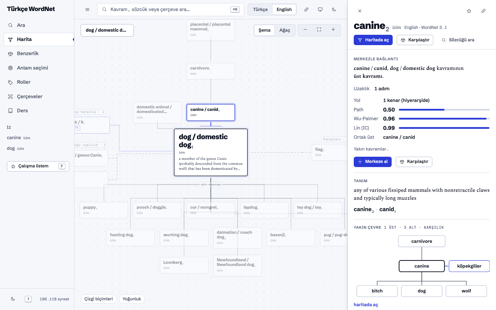
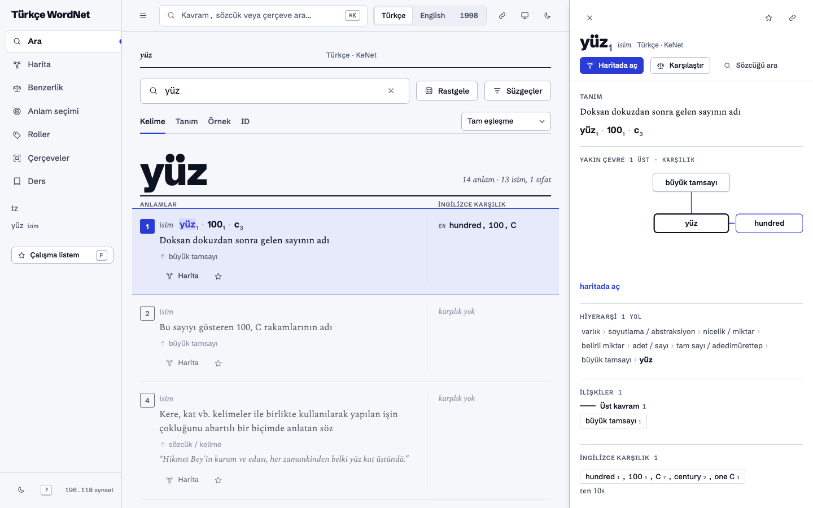
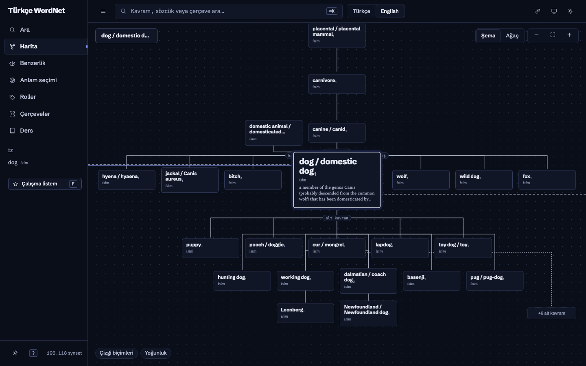

<h1 align="center">Türkçe WordNet · PropBank · FrameNet Arayüzü</h1>

<p align="center">
<a href="README.md"></a> <a href="README.tr.md"></a>
</p>

<p align="center">
<a href="https://www.mef.edu.tr/"></a>
<a href="LICENSE"></a>
<a href="data/README.md"></a>
</p>

> **Ders çalışma için üretilmiştir.** Bu repo, **MEF Üniversitesi COMP 451 – Doğal Dil İşlemeye Giriş** dersi (Güz 2026) için çalışma aracı olarak hazırlandı. Bir öğrenci projesidir; resmî ders materyali değildir ve üniversiteyle bağlantılı değildir.

Derste işlenen sözcüksel anlambilim kaynaklarını (Türkçe ve İngilizce WordNet, PropBank, FrameNet, VerbNet) keşfetmek için yerel, bağımlılıksız bir web uygulaması (Python 3 standart kütüphanesi + vanilla JS): benzerlik ölçüleri, anlam seçimi (WSD) ve kavram haritası dahil.

<p align="center">
  
  
</p>
<p align="center"></p>

## Hızlı başlangıç

```bash
git clone https://github.com/minniesmick/turkish-wordnet-ui
cd turkish-wordnet-ui
python3 server.py        # sonra http://127.0.0.1:8770
```

Veri (yaklaşık 116 MB) `data/` içinde hazır. İlk açılışta belleğe yüklenmesi birkaç saniye sürer. `pip install` gerekmez.

## Veri kaynakları

Tüm veri açık kaynaktır. Dosyalar `data/` içinde durur; orijinaline gitmek için düğmelere tıkla.

<p>
<a href="https://github.com/StarlangSoftware/TurkishWordNet"></a>
<a href="https://github.com/StarlangSoftware/TurkishPropBank"></a>
<a href="https://github.com/StarlangSoftware/TurkishFrameNet"></a>
<a href="https://github.com/propbank/propbank-frames"></a>
<a href="https://github.com/nltk/nltk_data"></a>
<a href="https://framenet.icsi.berkeley.edu/"></a>
<a href="https://wordnet.princeton.edu/"></a>
<a href="https://verbs.colorado.edu/verbnet/"></a>
<a href="https://propbank.github.io/"></a>
</p>

Dosya bazında kaynak, lisans ve yeniden indirme komutları: **[data/README.md](data/README.md)**.

## Veri dosyaları (ayrıntı)

| Dosya | Repodaki yeri | İçerik |
|---|---|---|
| `turkish_wordnet.xml` | `src/main/resources/` | Güncel KeNet: 78.327 synset, ilişkiler, İngilizce bağlantılar (ILR), örnekler |
| `english_wordnet_version_31.xml` | `src/main/resources/` | Princeton WordNet 3.1: 117.791 synset, ilişkiler |
| `turkish1998_wordnet.xml` | repo kökü | 1998 sözlük sürümü: 67.897 synset (ilişki yok) |

Veriyi yeniden indirmek için:

    B=https://raw.githubusercontent.com/StarlangSoftware/TurkishWordNet/master
    curl -L -o data/turkish_wordnet.xml $B/src/main/resources/turkish_wordnet.xml
    curl -L -o data/english_wordnet_version_31.xml $B/src/main/resources/english_wordnet_version_31.xml
    curl -L -o data/turkish1998_wordnet.xml $B/turkish1998_wordnet.xml

Veri CC BY-SA 4.0 lisanslıdır (Starlang Software). Tüm veri kaynakları, bağlantıları ve lisansları için bkz. [data/README.md](data/README.md).

### NLTK veri deposundan gelen ek veriler

Elimizdeki Starlang verisinde olmayan ama derse gereken şeyler `nltk_data` paketlerinden üretilir (`python3 scripts/build_nltk.py`,
kaynakları kendisi indirir; ~120 MB indirme, birkaç dakika). Paketler: `wordnet31`, `semcor`, `senseval`, `verbnet3`, `framenet_v17`.

| Çıktı (`data/`) | NLTK paketi | Ne sağlıyor |
|---|---|---|
| `wn31_extra.json.gz` | wordnet31 | İngilizce anlam numarası = sıklık sırası + SemCor sayısı, örnek cümleler, lexname kategorisi, fiil cümle kalıpları |
| `semcor.json.gz` | semcor | 35.795 cümle / 224.149 anlam etiketi: denetimli WSD (Naive Bayes) ve bilgi içeriği (IC) tabanlı benzerlik |
| `senseval.json.gz` | senseval | SENSEVAL-2 `hard`, `interest`, `line`, `serve` (slayttaki *interest* örneği) |
| `verbnet.json` | verbnet3 | VerbNet 3.3: 594 sınıf, üyeler, tematik roller, çerçeveler, anlam yüklemleri |
| `framenet_lu_ex.json.gz` | framenet_v17 | Sözcük birimi başına anotasyonlu örnek cümleler (16.686 örnek) |

Sunucu bu dosyalar yoksa yine çalışır; ilgili özellikler devre dışı kalır.

### Roller ve çerçeveler (PropBank / FrameNet)

| Dosya | Kaynak | İçerik |
|---|---|---|
| `turkish-propbank.xml` | Starlang `TurkishPropBank` (`src/main/resources/`) | TRopBank: 17.526 KeNet fiil synset'i için ARG0–ARG4, işlev etiketi, durum eki, açıklama |
| `framenet.xml` | Starlang `TurkishFrameNet` (`src/main/resources/`) | Türkçe FrameNet: 809 çerçeve, KeNet synset'leri olarak sözcük birimleri |
| `propbank_en.json` | PropBank 3.4 frame dosyaları (propbank/propbank-frames, CC BY-SA 4.0) | 11.198 roleset, örnek cümleler, FrameNet/VerbNet bağlantıları |
| `framenet_en.json` | FrameNet 1.7 (ICSI, CC BY 3.0; NLTK veri deposu üzerinden) | 1.221 çerçeve: tanım, elemanlar, sözcük birimleri, çerçeve ilişkileri |

İngilizce iki JSON dosyası bir kez üretilir (kaynakları kendisi indirir; ~100 MB, birkaç dakika):

    python3 scripts/build_srl.py

Türkçe iki XML dosyasını indirmek için:

    B=https://raw.githubusercontent.com/StarlangSoftware
    curl -L -o data/turkish-propbank.xml $B/TurkishPropBank/master/src/main/resources/turkish-propbank.xml
    curl -L -o data/framenet.xml $B/TurkishFrameNet/master/src/main/resources/framenet.xml

## Özellikler

- Kelime / tanım / örnek / ID araması; tam, başlar, biter, içerir, "ifade içinde sözcük" eşleşmeleri
- Tür (POS) süzgeci (sayılarla), anlam numarası süzgeci, "örnek cümlesi olanlar"
- ç/ğ/ı/ö/ş/ü farkını yok sayma seçeneği
- Kartta **İlişkiler**: üst kavram zinciri, alt kavramlar, zıt anlamlılar, parça-bütün vb.
- Türkçe ↔ İngilizce karşılıklar (mavi EN / TR etiketleri)
- Arama durumu URL'de saklanır, geri tuşu ve paylaşım çalışır

### Ders sekmeleri (COMP 451 · Lecture 4 slaytlarına göre)

- **Benzerlik**: iki sözcük arasında eş anlamlı / zıt anlamlı / alt-üst kavram / ortak üst kavram (LCS) ilişkisi,
  yol uzunluğu, path benzerliği (1/(yol+1)) ve Wu-Palmer; hiyerarşi yolu görsel olarak çizilir.
- **Anlam seçimi (WSD)**: basitleştirilmiş / genişletilmiş **Lesk** (bağlam–tanım örtüşmesi, idf ağırlıklı).
  Doğruluğu sınırlıdır; yöntemin zayıf yanlarını görmek için tasarlandı.
- **Morfoloji**: Türkçe sözcüğü gerçek [Zemberek](https://github.com/ahmetaa/zemberek-nlp) çözümleyicisiyle (Apache 2.0; isteğe bağlı: `zemberek-full.jar` dosyasını `lib/` içine koy ve bir JDK kur) ya da küçük yerleşik kural motoruyla morfemlerine ayır (`okul+Noun+A3sg+P1sg+Nom`),
  cümle bağlamında belirsizlik gider, kök + eklerden Zemberek'in WordGenerator'ıyla sözcük üret (küçük yerleşik motor yalnızca çevrimdışı yedek); yanında BOUN'daki gerçek çözümlemeler. Öğrenci kipi: kural izi, dersteki `From State a-State b` biçiminde Oflazer FSM yolu, etiket sözlüğü, alıştırma (Lecture 2).
- **Ayrıştırma**: CFG / PCFG yaz (kuralın sonuna `[olasılık]`), cümle ver; CKY tablosu hücre hücre dolar, tüm ayrıştırma ağaçları SVG çizilir,
  PCFG en olası ağacı ve cümle olasılığını bulur; parantezli ağaçlardan kural olasılıklarını MLE ile öğrenip grameri doğrudan kullanabilirsin (Lecture 3, InClass 2 ve 3). Tarayıcıda çalışır.
- **Bağımlılık**: UD Turkish-BOUN (test kümesi, 979 cümle) cümlesi seç ya da CoNLL-U yapıştır; bağımlılık okları ve baş–bağımlı ağacı çizilir,
  ağaç özellikleri (tek kök, bağlı, tek başlı, döngüsüz, projektif) kontrol edilir, ilişkiler açıklanır, etiketler gizlenip kendin deneyebilirsin (Lecture 3, InClass 4).
- **Korpus**: UD Turkish-BOUN (lemma ve UPOS destekli) ya da Brown cümleleri üzerinde sözcük ve n-gram sıklık listeleri, Zipf grafiği, type/token oranı ve bağlam satırları (KWIC) (Lecture 5).
- **N-gram**: kendi metnin, BOUN ya da Brown üzerinde unigram / bigram / trigram tabloları, sonraki sözcük tahmini, adım adım cümle olasılığı ve perplexity,
  **Laplace, backoff ve interpolation** yumuşatma, bilinmeyen sözcük için **UNK**, rastgele cümle üretimi, eğitim/test perplexity karşılaştırması ve **PMI** (birlikte geçiş, benzer bağlamlı sözcükler) (Lecture 5).
- **Kullanım kipi**: üst çubuktaki **Araç / Öğrenci** anahtarı normal kullanımı çalışmadan ayırır. Araç kipi yalnızca sonuç verir; Öğrenci kipi ders bağlantıları,
  formüller, adım adım açıklama, kural izi, alıştırma ve sınavları (ve Ders sekmesini) açar: CKY tablosunu kendin doldurup hücre hücre kontrol ettir, n-gram olasılıklarını ve tablo satırlarını elle hesapla, etiketleri gizleyerek bağımlılık ağacını dene. Öğretici öğeler `.stu` sınıfıyla işaretlidir.
- **Ders**: slayt kavramları (homonymy, polysemy, synonymy, antonymy, hypernym/hyponym, ilişki tabloları, bass yolları,
  ID alıştırması, Q/A zorlukları) hazır sorgularla; veriden otomatik üretilen quiz (üst kavram / ilişki türü).
- Kartlarda **↑ üst kavram** ipucu, çoklu hypernym yolları ve sözcük başlığında çok anlamlılık özeti.
- ID alanı KeNet'te bağlı İngilizce `ENG31-…` kimliklerini de arar (slayttaki alıştırma).
- **Roller (PropBank)**: İngilizce roleset sözlüğü (fiil / rol tanımı / FrameNet / VerbNet ile arama, işlev süzgeci, renkli örnek
  cümleler) ve TRopBank (durum eki ve işlev süzgeçli); **Cümle etiketle**: Türkçe cümlede yüklemi bulur, KeNet+Lesk ile aday
  çerçeve seçer, durum eklerine bakarak ARG0/ARG1'i yerleştirir (kural tabanlı, durum eki tahmini elle düzeltilebilir);
  **Rol sınavı**: PropBank altın örneklerinden rol bulma.
- **Çerçeveler (FrameNet)**: çerçeve adı / sözcük birimi (agree.v) / eleman / tanım ile arama, renkli FE örnekleri,
  çerçeve ilişkileri, bağlı PropBank roleset'leri ve Türkçe karşılık sözcük birimleri.
- WordNet kartlarında **ROLLER** ve FrameNet çerçeve çipleri, ilişkiler panelinde TRopBank argüman tablosu.
- **WSD → Naive Bayes**: SemCor / SENSEVAL-2 üzerinde denetimli anlam seçimi (bağlam torbası + yan sözcükler), kararı belirleyen
  özellikler, 5-kat çapraz doğrulama ve MFS / Lesk ile karşılaştırma (interest: NB ≈ %91, MFS ≈ %53).
- **Benzerlik** sekmesinde İngilizce için IC tabanlı Resnik / Lin / Jiang-Conrath.
- **Roller → VerbNet 3.3**: sınıf / üye / tematik rol / yüklem araması; PropBank kartlarındaki VN etiketleri sınıfa, sınıftaki
  üyeler PropBank rolesetine bağlanır.
- **Çerçeveler**: sözcük birimine tıklayınca FrameNet anotasyonlu örnekler (FE renkli).
- Ara sekmesi İngilizce: anlam numarası/sıklık, lexname süzgeci, örnek cümleler, fiil kalıpları.


## Arayüz (yeniden tasarım)

Tasarım yönü **İki Renkli Sözlük**: baskı sözlüğünün sayfa dili, modern bir SaaS çalışma alanına çevrildi. Soğuk ince kâğıt, mavi-siyah mürekkep,
tek leke renk (ultramarin; yalnızca tıklanabilir ve odaktaki şeylerde). Kategori renkle değil çizgi biçimiyle ayrılır.
Yazı tipleri `static/fonts/` altında yerel (Schibsted Grotesk, Spectral, JetBrains Mono).

- **Odaklanma**: Ara'da bir anlama tıkla; diğer anlamlar söner, sağda kenar kâğıdı açılır (tanım, hiyerarşi yolları, ilişkiler, karşılık, roller, not).
- **Harita** (`v=graph`): kavramın hiyerarşisi ve bağları ilişkisel ağaç olarak. Düğüme tıkla → yol vurgulanır, kâğıtta bağ türü, uzaklık ve benzerlik
  (path, Wu-Palmer, Lin) görünür; çift tıkla → merkeze al; iz (breadcrumb), kardeş kavramlar, çizgi biçimine göre süzme, **Şema / Ağaç** görünümü.
- **⌘K komut paleti**: sözcük, çerçeve, roleset, VerbNet sınıfı ve komutlar. `?` tüm kısayolları gösterir (`g s/h/b/w/r/f/d`, `j/k`, `m`, `f`, `p`, `t`).
- **Çalışma listem**: favoriler, notlar, gezi izi tarayıcıda (localStorage) saklanır; Markdown olarak kopyalanabilir.
- **Sunum modu** (`P`): büyük yazı, kenar çubukları sönük. Her ekranın bağlantısı (`link` düğmesi) aynı durumu açar; `?theme=dark|light` temayı seçer.

Kaynak yapı: `static/index.html` (kabuk), `static/css/app.css`, `static/js/*.js` (ES modülleri; derleme adımı yok).

## Lisans

Kod: [MIT](LICENSE). Veri: her kaynağın kendi lisansı, ayrıntı [data/README.md](data/README.md) içinde. Yazı tipleri (Schibsted Grotesk, Spectral, JetBrains Mono): SIL Open Font License 1.1.
Yapılacaklar: [TODO.md](TODO.md).
